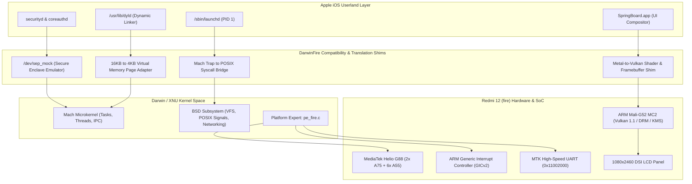

# Architecture & Subsystem Interaction Model

This document outlines the software and hardware boundary interactions within **Project DarwinFire**.

## System Boot Phasing
1. **Stage 1 (Bootloader Handoff):** Fastboot / LittleKernel transfers execution to XNU entry at `0x40080000`.
2. **Stage 2 (Platform Expert Init):** `pe_fire_identify_machine()` configures serial logging on MTK UART and maps GICv2.
3. **Stage 3 (VM Setup):** Mach VM initializes physical memory layout using the 4GB DRAM base (`0x40000000`).
4. **Stage 4 (RootFS Mount):** APFS container image mounted as the root partition.
5. **Stage 5 (Userland Spawn):** `launchd` starts and Mach message routing begins.
6. **Stage 6 (Hardware Shims Active):** `sep_mock` handles encryption queries; `Metal-to-Vulkan` redirects graphics rendering to the Mali GPU.
