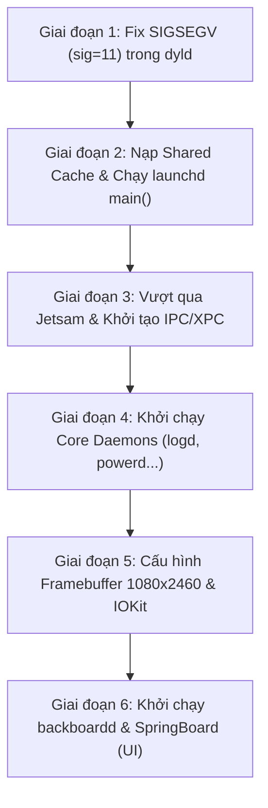

# DARWIN-FIRE: MASTER ROADMAP & HANDOVER GUIDE CHO CLAUDE
**Dự án:** Khởi chạy Apple iOS 16.7.16 Userland trên Xiaomi Redmi 12 ("fire" / MediaTek Helio G88 MT6768)  
**Tác giả:** Antigravity & Claude  
**Mục tiêu tối thượng:** Chạy hoàn chỉnh từ Kernel XNU, vượt qua `dyld`, kích hoạt `launchd`, khởi chạy các daemon hệ thống, nạp bộ điều phối đồ hoạ `backboardd` và khởi chạy giao diện người dùng **SpringBoard** (Màn hình khóa / Màn hình chính của iPhone X) trên màn hình LCD của Redmi 12.

---

## 1. TỔNG QUAN HỆ THỐNG & PHẦN CỨNG MỤC TIÊU

| Thành phần | Thông số chi tiết |
| :--- | :--- |
| **Thiết bị mục tiêu** | Xiaomi Redmi 12 (Tên mã: `"fire"`) |
| **SoC / Chipset** | MediaTek Helio G88 (MT6768 / MT6769H) |
| **Cấu trúc CPU** | 8 nhân ARMv8.2-A: 2x Cortex-A75 (big, 2.0 GHz) + 6x Cortex-A55 (LITTLE, 1.8 GHz) |
| **Kiến trúc tập lệnh** | Thuần `arm64` (**KHÔNG có PAC / `arm64e`**, không có SPTM Apple, không có APRR) |
| **GPU & Màn hình** | ARM Mali-G52 2EEMC2; Màn hình IPS LCD $1080 \times 2460$ (địa chỉ Framebuffer vật lý: `0x7ce6a000`, pitch: 4320) |
| **Bộ nhớ & Lưu trữ** | 4GB/8GB LPDDR4X; 128GB eMMC 5.1 (Phân vùng `super` Android dung lượng 8.5GB) |
| **Hệ điều hành đích** | Apple iOS 16.7.16 (Build `20H392`), iPhone X (`iPhone10,6` / Target: `D221` / Board: `d221ap`) |
| **Kernel Darwin/XNU** | Mã nguồn mở APSL `xnu-8796` (macOS 13.5 branch), build qua `blacktop/darwin-xnu-build` |
| **RootFS** | 8.2GB HFS+ disk image (`ios16_root.img`) flash tại phân vùng Android `super` |

---

## 2. TRẠNG THÁI HIỆN TẠI & CÁC CỘT MỐC ĐÃ HOÀN THÀNH 100%

Toàn bộ các bước sau đã được kiểm chứng hoạt động thực tế trên phần cứng vật lý qua màn hình điện thoại:

1. **Bootloader Handoff & EL1 Kernel Bring-up:**
   - LK Bootloader nạp `out/xnu_arm64_boot.img`, nhảy vào Heartbeat Trampoline tại `0x4008c000`.
   - Thiết lập bảng phân trang Identity Mapping (V=P), nhảy vào XNU physBase `0x43004000` tại entry point `0x433ab488`.
   - Driver UART MTK (`0x11002000`), Generic Timer (CNTV), bộ điều khiển ngắt GICv3 (`df_irq_stat`) và driver eMMC (`df_emmc.c`) hoạt động ổn định.
2. **Chuyển cấp thực thi sang Userland EL0:**
   - Kernel thực thi `load_init_program` thành công, nạp `/sbin/launchd` và nhường quyền cho `/usr/lib/dyld`.
   - Mở thành công 3 bộ mô tả file chuẩn: `fd 0` (`/dev/null`), `fd 1` (`/dev/null`), `fd 2` (`/dev/console`).
3. **Bypass Code Signing & Cấp quyền Entitlements:**
   - Cờ chữ ký tiến trình: `csflags = 0x24000001` (`CS_VALID | CS_PLATFORM_BINARY | CS_SIGNED`).
   - Hàm `csblob_get_entitlements` và `csblob_get_der_entitlements` trong `bsd/kern/ubc_subr.c` (Commit `f39db59`) trả về trực tiếp DER Entitlements (1,105 bytes) và XML Entitlements (1,677 bytes) của Apple khi không có driver AMFI.
4. **Truy vấn cấu hình phần cứng (Hardware Target Queries):**
   - `PEGetTargetName` $\rightarrow$ `"d221ap"`.
   - `sysctl hw.targettype` $\rightarrow$ `"D221"`.
   - `PEGetProductName` $\rightarrow$ `"iPhone10,6"`.
   - Các syscall `sysctl.name2oid` và `sysctl` số 202 trả về `err 0 rv 0`.
5. **Khắc phục lỗi APFS Root Status `fsctl` (Commit `79cf3b5`):**
   - Intercept lệnh `fsctl("/", 0x40084a6a)` (Syscall 242) trong `bsd/dev/arm/systemcalls.c`, trả về cấu trúc trạng thái 0 (Root sạch) và `err 0 rv 0`. Đồng thời chuyển các mã lỗi chưa hỗ trợ sang chuẩn POSIX `ENOTTY` (25).
   - Kiểm chứng trên LCD:
     ```text
     374 fire sys 242 (cmd 0x40084a6a) pid 1 >
     374 fire sys 242 < err 0 rv 0
     375 fire sys 345 (/) pid 1 >
     375 fire sys 345 < err 0 rv 0
     ```
     -> **Lỗi `sig=6` (`SIGABRT` do `failed to query root device status: 22`) đã được xóa bỏ hoàn toàn!**
6. **Mở rộng bộ ghi log ngoại lệ EL0 (Commit `b1b48f7` của Claude):**
   - Đã tách riêng quota cho syscall (`ec == 0x15`), đảm bảo mọi ngoại lệ Data Abort / Translation Fault (`ec != 0x15`) đều được in ra màn hình LCD kèm địa chỉ `PC` và `FAR`.

---

## 3. LỘ TRÌNH TỔNG THỂ TỪ HIỆN TẠI ĐẾN GIAO DIỆN IOS (MASTER ROADMAP)



---

### GIAI ĐOẠN 1: KHẮC PHỤC LỖI `SIGSEGV` (sig=11) TRONG `dyld` (Điểm nghẽn hiện tại)

Ngay sau lệnh `statfs64("/")` (Syscall 345), tiến trình PID 1 thoát với:
```text
375 fire launchd exit: sig=11 csflags=0x24000001
376 pid 1 exited -- exit reason namespace 2 subcode 0xb, description none
```
`sig=11` (`0xb`) là `SIGSEGV` (Segmentation Fault / Data Abort).

#### Phân tích mã nhị phân ARM64 của `dyld` (`extracted_binaries/ios16_x/binaries/dyld`):
Tại vị trí `0x60f0c` đến `0x61148` (hàm `_configuration_init`):
```assembly
   60f0c: bl   _statfs                     ; Syscall 345: statfs64("/") -> Thành công (err 0)
   60f10: cbnz w0, 0x61168
   60f14: str  x21, [x21, #0x878]          ; Ghi con trỏ struct statfs vào __DATA_DIRTY
   60f18: ldr  x0, [x20, #0x10]            ; Đọc con trỏ envp
   60f1c: cbz  x0, 0x60f70                 ; Nếu envp rỗng -> nhảy qua getenv
   ...
   60fb8 - 610d0: Quét boot-args ("rd", "md0", "arp0", "rp", "rootdmg-ramdisk")
   ...
   6111c: mov  x8, #0xfffff0000            ; Base CommPage TTBR0
   61120: movk x8, #0x4084                 ; x8 = 0x0000000FFFFF4084 (_COMM_PAGE64_RO_ADDRESS + 0x84)
   61124: ldr  w8, [x8]                    ; Đọc _COMM_PAGE_CPU_CAPABILITIES64
   61128: str  w8, [x22, #0x1208]
   6112c: str  x22, [x8, #0x1e0]
   61134: add  sp, sp, #0x600
   61148: ret
```

#### Hai nguyên nhân gây Crash tiềm năng:
1. **Truy cập CommPage Apple (`0x0000000FFFFF4084`):**
   - Tại dòng `61124`, `dyld` đọc trường CPU Capabilities từ CommPage chỉ đọc `_COMM_PAGE64_RO_ADDRESS` (`0x0000000FFFFF4000`).
   - Nếu XNU chưa ánh xạ vùng nhớ này vào Task Map của PID 1 với quyền `VM_PROT_READ`, CPU sẽ kích hoạt `Translation Fault` (SIGSEGV).
   - **Cách xử lý:** Trong `osfmk/arm/commpage/commpage.c` và `vm_commpage_enter`, đảm bảo `_COMM_PAGE64_RO_ADDRESS` (`0x0000000FFFFF4000`) và `_COMM_PAGE64_BASE_ADDRESS` (`0x0000000FFFFFC000`) được map vào user task.
2. **Cấu trúc Stack ban đầu của `load_init_program`:**
   - Tại `60f18`, `ldr x0, [x20, #0x10]` đọc `envp`. Đảm bảo kernel khi dựng stack ban đầu cho PID 1 tại `bsd/kern/kern_exec.c` tạo đúng cấu trúc mảng con trỏ chuẩn POSIX/Mach-O:
     - `sp + 0`: `argc` (1)
     - `sp + 8`: `argv[0]` (con trỏ trỏ tới chuỗi `"/sbin/launchd"`)
     - `sp + 16`: `argv[1]` (`NULL`)
     - `sp + 24`: `envp[0]` (`NULL` hoặc con trỏ `PATH=...`)
     - `sp + 32`: `apple[0]` (con trỏ `executable_path=/sbin/launchd`)

---

### GIAI ĐOẠN 2: NẠP SHARED CACHE & KHỞI CHẠY `launchd main()`

Sau khi `dyld` hoàn tất khởi tạo cấu hình môi trường:
1. **Nạp `dyld_shared_cache_arm64`:**
   - `dyld` sẽ tìm nạp file bộ đệm thư viện dùng chung tại:
     `/System/Library/Caches/com.apple.dyld/dyld_shared_cache_arm64`
   - Quá trình này sử dụng syscall `shared_region_check_np` (syscall 294) và `shared_region_map_and_slide_2_np` (syscall 516).
   - **Lưu ý:** Đảm bảo `shared_region.c` trong XNU chấp nhận nạp cache mà không đòi hỏi kiểm tra chữ ký nghiêm ngặt (đã được tắt trong `kern_cs.c`).
2. **Chuyển quyền điều khiển sang `launchd`:**
   - `dyld` giải quyết các liên kết ký hiệu động (symbols) của `launchd` với `libSystem.B.dylib`.
   - Nhảy vào hàm `main()` của `/sbin/launchd` tại `0x100000000 + entry_offset`.

---

### GIAI ĐOẠN 3: VƯỢT QUA CÁC CHỐT CHẶN CỦA `launchd` (Jetsam, Entitlements, XPC)

Khi `launchd` bắt đầu chạy hàm `main()`:
1. **Cấu hình Jetsam Properties:**
   - `launchd` sẽ đọc cấu hình quản lý bộ nhớ từ:
     `/System/Library/LaunchDaemons/com.apple.jetsamproperties.D221.plist`
   - **Quy tắc quan trọng (Tránh Crash):** Trong mã nguồn `launchd` (offset `0x10000ff58`), nếu cả `com.apple.jetsamproperties.NonUI.plist` VÀ file theo target `com.apple.jetsamproperties.D221.plist` cùng tồn tại, `launchd` sẽ kích hoạt assertion:
     *"both NonUI & target-specific JetsamProperties plists are present. This is an error in the OS build configuration."*
     -> Chỉ giữ lại duy nhất file `com.apple.jetsamproperties.D221.plist` trên RootFS!
2. **Khởi tạo Mach Ports & IPC:**
   - `launchd` tạo các cổng IPC cơ bản thông qua `mach_port_allocate` và `mach_port_insert_right`.
   - Kernel cấp quyền quản trị qua cổng `host_priv()`.
3. **Kích hoạt XPC System Session Domain:**
   - `launchd` nạp danh sách dịch vụ hệ thống từ thư mục `/System/Library/LaunchDaemons/`.

---

### GIAI ĐOẠN 4: KHỞI CHẠY CÁC DAEMONS CỐT LÕI (Core iOS Daemons)

Để iOS không bị treo chờ dịch vụ (hang/timeout), `launchd` sẽ spawn các daemon cốt lõi theo thứ tự phụ thuộc:

1. **`logd` (`com.apple.logd.plist`):**
   - **Tối quan trọng!** Tất cả các daemon của Apple (`os_log`) đều gửi log qua Mach message tới `logd`. Nếu `logd` không chạy, các tiến trình khác sẽ bị nghẽn (deadlock) khi cố gắng ghi log khởi động.
2. **`powerd` (`com.apple.powerd.plist`):**
   - Quản lý trạng thái nguồn và màn hình hiển thị.
3. **`fseventsd` & `diskarbitrationd`:**
   - Quản lý các điểm gắn kết ổ đĩa (Mount points). Cần đảm bảo phân vùng `/private/var` được gắn kết để các dịch vụ ghi dữ liệu tạm.
4. **Bypass Daemon yêu cầu phần cứng SEP (`keybagd`):**
   - Redmi 12 không có chip Secure Enclave (SEP) của Apple.
   - Tập lệnh `tools/make_ios16_hfs.sh` đã đổi tên `com.apple.keybagd.plist` thành `.bak` để ngăn `launchd` khởi chạy tiến trình này gây sập hệ thống.

---

### GIAI ĐOẠN 5: ĐỒ HOẠ & MÀN HÌNH HIỂN THỊ (Display & Framebuffer Pipeline)

Để hiển thị hình ảnh đồ họa iOS lên màn hình Redmi 12:

1. **Thông số Framebuffer phần cứng:**
   - Độ phân giải: $1080 \times 2460$, 32bpp BGRA.
   - Địa chỉ vật lý: `0x7ce6a000` (được LK Bootloader thiết lập sẵn).
   - Pitch: `4320` bytes mỗi hàng.
2. **Ánh xạ IOKit Framebuffer trong XNU:**
   - Tạo driver/kext ánh xạ tuyến tính (`IOFramebuffer` hoặc `IOGraphicsAccelerator` shim) trong XNU:
     - Khai báo frame buffer kích thước $1080 \times 2460$ tại `0x7ce6a000`.
     - Cung cấp cổng IOKit `IOFramebufferUserClient` để userland của Apple nhận diện màn hình chính.

---

### GIAI ĐOẠN 6: KHỞI CHẠY GIAO DIỆN NGƯỜI DÙNG (BackBoard & SpringBoard)

1. **Khởi chạy `backboardd` (`com.apple.backboardd.plist`):**
   - `backboardd` là daemon compositor cấp thấp của Apple.
   - Nhiệm vụ: Mở thiết bị đồ hoạ (`/dev/fb0` hoặc IOKit display), quản lý luồng sự kiện cảm ứng (Touch Events) và quản lý chuyển đổi ứng dụng.
2. **Khởi chạy `SpringBoard` (`com.apple.SpringBoard.plist`):**
   - `SpringBoard` là giao diện đồ họa chính của iOS.
   - Nạp framework `UIKitCore`, `FrontBoard`, `MaterialKit`.
   - **KẾT QUẢ ĐẠT ĐƯỢC:** Màn hình Redmi 12 sáng lên giao diện **Màn hình khóa (LockScreen) của iOS 16**: hiển thị đồng hồ số lớn, thanh trạng thái pin/sóng, và vuốt mở khóa vào màn hình chính chứa các ứng dụng của Apple!

---

## 4. BẢNG HƯỚNG DẪN THAO TÁC NHANH (QUICK COMMANDS)

Toàn bộ quy trình từ code đến máy thật được gói gọn trong 4 bước:

```bash
# BƯỚC 1: Commit bản vá và đẩy lên GitHub (Tự động kích hoạt GitHub Actions build)
git add xnu/fix-xcode16.sh
git commit -m "fix(xnu): your descriptive message"
git push origin master:main

# BƯỚC 2: Theo dõi và tải Artifact về thư mục out/
gh run list -L 2
gh run download <RUN_ID> -D out/p_live

# BƯỚC 3: Đóng gói Kernel phẳng & Android Boot Image
node tools/xnu_flatten.js out/p_live/xnu-arm64-vmapple/kernel.release.vmapple out/xnu_arm64.flat extracted_binaries/fire_devicetree.adt out/p_live/fire-root-hfs/fire_root.img
node tools/bootimg_builder.js out/heartbeat.bin out/xnu_arm64_boot.img - out/xnu_arm64.flat.ramdisk

# BƯỚC 4: Flash vào điện thoại Xiaomi Redmi 12 (đang ở chế độ Fastboot)
fastboot flash boot_a out/xnu_arm64_boot.img
fastboot flash boot_b out/xnu_arm64_boot.img
fastboot reboot
```

---

## 5. CẨM NANG GIẢI MÃ CÁC MÃ LỖI ĐẶC TRƯNG CỦA APPLE XNU

| Mã lỗi hiển thị | Tên chuẩn trong XNU | Ý nghĩa kỹ thuật & Vị trí kiểm tra |
| :--- | :--- | :--- |
| `namespace 2 subcode 0x6` | `OS_REASON_SIGNAL` (`SIGABRT`) | Tiến trình tự gọi `abort()` do điều kiện kiểm tra (assertion) bị sai. Tra cứu chuỗi thông báo lỗi trong `__crash_info`. |
| `namespace 2 subcode 0xb` | `OS_REASON_SIGNAL` (`SIGSEGV`) | Lỗi truy cập bộ nhớ ảo (Data Abort / Translation Fault). Cần xem giá trị thanh ghi `PC` (lệnh gây lỗi) và `FAR` (địa chỉ con trỏ truy cập). |
| `namespace 7 subcode 0x1` | `OS_REASON_JETSAM` | Lỗi cấu hình Jetsam plist (ví dụ: tồn tại cả NonUI và D221 plist). |
| `namespace 35 subcode 0x6`| `OS_REASON_IGNITION` | Lỗi xảy ra trong module Cryptex `libignition` của `dyld` (ví dụ: `hw.target` sai hoặc `fsctl` root status trả về lỗi khác ENOTTY/0). |
