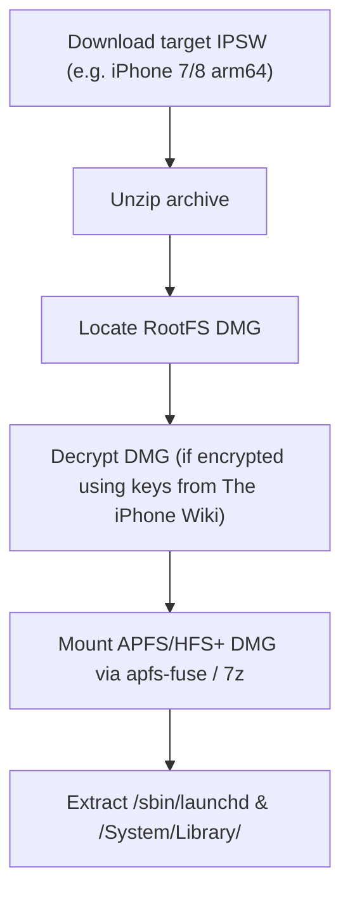

# IPSW Userland Pipeline & Binary Extraction Specification

## 1. IPSW Firmware Package Structure
An Apple `.ipsw` file is a ZIP archive containing:
* `BuildManifest.plist`: Firmware manifest with SHA-384 hashes, board IDs, and component paths.
* `Restore.plist`: Product version, build number, and hardware platform identifiers.
* `kernelcache.release.*`: Pre-linked XNU kernel + essential KEXT drivers (Mach-O ARM64).
* `0XX-XXXXX-XXX.dmg`: Root filesystem (APFS or HFS+ on legacy releases).
* `Firmware/`: Bootloader stages (`LLB`, `iBoot`), baseband firmware, and SEP firmware.

---

## 2. Extraction Pipeline

---

## 3. Reverse Engineering with `morluto/rea`

The tool **`morluto/rea`** (Reverse Engineer Anything) connects AI coding assistants directly with local decompilation engines (Ghidra, IDA, Hopper):

### Workflow Integration:
1. **Target Selection:** Identify critical proprietary binaries:
   * `/sbin/launchd`: Main service supervisor and PID 1.
   * `/usr/lib/dyld`: Dynamic linker.
   * `/System/Library/CoreServices/SpringBoard.app/SpringBoard`: UI compositor.
2. **REA Decompilation:**
   * Run REA agent to inspect unresolved symbols, system call numbers, and hardware checks.
   * Extract function prototypes for hardware interfaces (e.g., `_IOConnectCallMethod`, `_IORegistryEntryCreateCFProperty`).
3. **Shim Generation:**
   * Use REA analysis output to generate C-based stub libraries that intercept Apple IOKit calls and redirect them to Linux/Android `/dev/` nodes.
