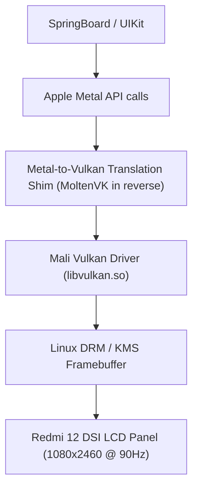

# Graphics Pipeline & SpringBoard Display Abstraction

## 1. The iOS Display Stack
Unlike Android which uses SurfaceFlinger and HAL drivers over Linux DRM/KMS:
* **iOS Graphics Pipeline:**
  * Application $\rightarrow$ **UIKit** $\rightarrow$ **CoreAnimation** $\rightarrow$ **Metal** $\rightarrow$ **Apple IOKit Graphics Driver (`AppleCLCD` / `IOMobileFramebuffer`)** $\rightarrow$ Screen.
* **SpringBoard Role:**
  * SpringBoard runs as the system compositor and window manager on top of `backboardd`.
  * `backboardd` handles touch inputs, hardware buttons (power, volume), and owns the primary display context.

---

## 2. Bridging to Mali-G52 GPU on Redmi 12

Redmi 12 exposes the **ARM Mali-G52 MC2** GPU via:
* Linux Kernel: `/dev/mali0` or `/dev/dri/card0` (Direct Rendering Manager - DRM).
* Userland API: **Vulkan 1.1** / **OpenGL ES 3.2**.

### Translation Layer Architecture:

### Display Server Shim Requirements:
1. Emulate `IOMobileFramebufferOpen()` and `IOMobileFramebufferSwapBegin()` using Linux `drmModePageFlip()`.
2. Map multi-touch events from Android Linux input device (`/dev/input/eventX`) to Apple `IOHIDEventSystemClient` Mach message packets.
