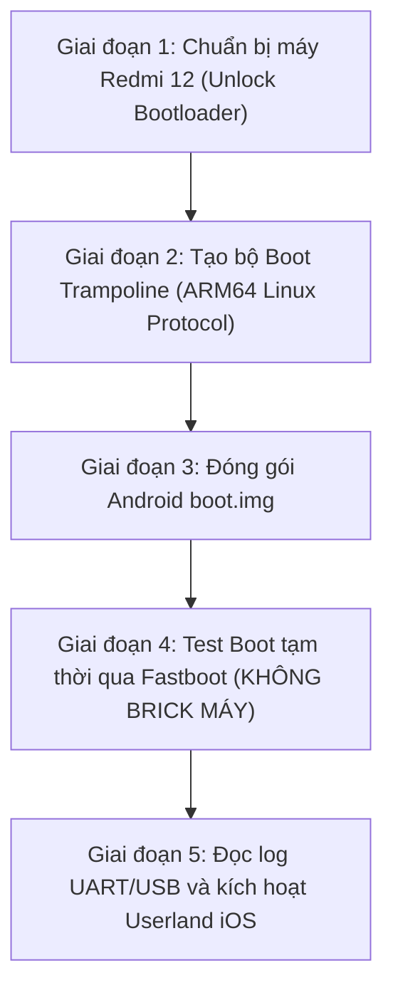

# Lộ trình thử nghiệm Boot ROM trên Redmi 12 ("fire")

Tài liệu này giải thích chi tiết câu hỏi: **"Khi nào và làm thế nào để tôi có thể bắt đầu nạp và test boot trên chiếc máy phụ Redmi 12?"**

---

## 🧭 Tổng quan lộ trình 5 giai đoạn



---

## 📋 Chi tiết từng giai đoạn

### Giai đoạn 1: Chuẩn bị thiết bị Redmi 12 (Đang chờ người dùng thực hiện)
*Để có thể nạp bất kỳ kernel hay bootloader tùy biến nào vào máy, bạn bắt buộc phải:*
1. **Đăng ký Unlock Bootloader trên Xiaomi:**
   - Vào `Cài đặt` $\rightarrow$ `Giới thiệu điện thoại` $\rightarrow$ Nhấp 7 lần vào `Phiên bản MIUI/HyperOS` để mở Menu Nhà phát triển.
   - Vào `Cài đặt bổ sung` $\rightarrow$ `Tùy chọn nhà phát triển` $\rightarrow$ Bật `Mở khóa OEM` và `Gỡ lỗi USB`.
   - Liên kết tài khoản Mi trong `Trạng thái mở khóa Mi`.
   - Dùng công cụ **Mi Unlock Tool** trên máy tính Windows để mở khóa (thường phải chờ 7 ngày theo chính sách của Xiaomi).
2. **Cài đặt Android Platform Tools trên PC:**
   - Cần có lệnh `adb` và `fastboot` để giao tiếp với điện thoại qua cáp USB.

---

### Giai đoạn 2: Tạo Boot Trampoline (Cầu nối XNU)
* Vấn đề: Bootloader của Redmi 12 (LittleKernel) chỉ nhận chuẩn boot của Linux ARM64:
  - Thanh ghi `x0` trỏ tới địa chỉ FDT (Device Tree).
  - CPU ở chế độ `EL1` hoặc `EL2`, MMU tắt, Data Cache tắt.
* Giải pháp trong repo:
  - Chúng ta đã viết mã **`kernel/trampoline/`**.
  - Trampoline đóng vai trò như một boot-shim: nhận điều khiển từ Fastboot, bật xung nhịp UART để xuất log gỡ lỗi, nạp payload XNU và nhảy tới `pe_fire_identify_machine`.

---

### Giai đoạn 3: Đóng gói `boot.img` chuẩn Android
* Bootloader của điện thoại không flash trực tiếp file `.ipsw` hay file `.bin` rời.
* Phải đóng gói thành cấu trúc **Android Boot Image Header v2**:
  - `Header`: Kích thước kernel, ramdisk, dtb, cmdline.
  - `Kernel`: Trampoline + XNU payload.
  - `Ramdisk`: Chứa `/sbin/launchd` và các shim giả lập.
  - `DTB`: Device tree của MediaTek MT6769H.
* Công cụ tự động: [`tools/bootimg_builder.js`](file:///d:/Code/IOS/tools/bootimg_builder.js).

---

### Giai đoạn 4: Thử nghiệm an toàn (Live RAM Boot - Không sợ brick)
**Đây là thời điểm bạn bắt đầu test boot thử:**
Khi bạn đã Unlock Bootloader xong chiếc Redmi 12:
1. Tắt nguồn điện thoại.
2. Giữ phím **Giảm âm lượng (-) + Nguồn** để vào chế độ **FASTBOOT** (màn hình hiện logo Fastboot màu cam).
3. Cắm cáp USB kết nối điện thoại với máy tính.
4. Chạy lệnh:
   ```bash
   fastboot boot out/darwin_fire_boot.img
   ```
> [!IMPORTANT]
> Lệnh `fastboot boot` sẽ nạp file vào thẳng thanh RAM của điện thoại và khởi chạy trực tiếp, **HOÀN TOÀN KHÔNG ghi đè phân vùng bộ nhớ eMMC của máy**. Nếu xảy ra lỗi hoặc treo máy, bạn chỉ cần giữ nút Nguồn 10 giây để máy tự khởi động lại về Android bình thường mà không hề bị mất dữ liệu hay brick!

---

### Giai đoạn 5: Đọc phản hồi từ máy
* Sau khi máy nhận lệnh boot, ta sẽ kiểm tra xem:
  1. Màn hình máy có phản hồi không?
  2. Cổng USB có nhận thiết bị gỡ lỗi (CDC Serial) không?
  3. Nếu máy khởi động lại ngay: Kiểm tra crash log qua `fastboot oem reboot-recovery` hoặc đọc console log.
